SQLite databases for teaching SQL. Databases 1–18 are based on [datenbanken-im-unterricht.de](https://www.datenbanken-im-unterricht.de/catalog.php) / [dbiu.de](https://www.dbiu.de/); the sources of all others are listed below.


### Overview

| Nr | Key | Tables | Rows | Relations | Suitable for |
|---|---|---|---|---|---|
| 1 | `dbiu.bahn` | 5 | 33237 | none | SELECT, WHERE, ORDER BY, GROUP BY; several independent tables |
| 2 | `dbiu.bayern` | 9 | 78139 | 1:n, m:n, self-reference | SELECT, WHERE, ORDER BY, GROUP BY; JOIN over 1:n; JOIN over junction tables (m:n); self-join |
| 3 | `dbiu.bundestag` | 3 | 16762 | 1:n | SELECT, WHERE, ORDER BY, GROUP BY; JOIN over 1:n |
| 4 | `dbiu.bundestag_einfach` | 1 | 737 | none | SELECT, WHERE, ORDER BY, GROUP BY (no JOINs) |
| 5 | `dbiu.film_fernsehen` | 2 | 198345 | none | SELECT, WHERE, ORDER BY, GROUP BY; several independent tables |
| 6 | `dbiu.haushaltsausstattung` | 1 | 1330 | none | SELECT, WHERE, ORDER BY, GROUP BY (no JOINs) |
| 7 | `dbiu.straftaten` | 5 | 955644 | 1:n | SELECT, WHERE, ORDER BY, GROUP BY; JOIN over 1:n |
| 8 | `dbiu.straftaten_einfach` | 1 | 669 | none | SELECT, WHERE, ORDER BY, GROUP BY (no JOINs) |
| 9 | `dbiu.kunstsammlung` | 5 | 21929 | m:n | SELECT, WHERE, ORDER BY, GROUP BY; JOIN over junction tables (m:n) |
| 10 | `dbiu.ladepunkte` | 3 | 103680 | 1:n | SELECT, WHERE, ORDER BY, GROUP BY; JOIN over 1:n |
| 11 | `dbiu.laenderspiele` | 1 | 43375 | none | SELECT, WHERE, ORDER BY, GROUP BY (no JOINs) |
| 12 | `dbiu.lebensmittel` | 1 | 1018 | none | SELECT, WHERE, ORDER BY, GROUP BY (no JOINs) |
| 13 | `dbiu.schulstatistik` | 1 | 755640 | none | SELECT, WHERE, ORDER BY, GROUP BY (no JOINs) |
| 14 | `dbiu.studierende` | 2 | 6960 | 1:n | SELECT, WHERE, ORDER BY, GROUP BY; JOIN over 1:n |
| 15 | `dbiu.unfallstatistik` | 1 | 2243 | none | SELECT, WHERE, ORDER BY, GROUP BY (no JOINs) |
| 16 | `dbiu.videospiele_einfach` | 1 | 38984 | none | SELECT, WHERE, ORDER BY, GROUP BY (no JOINs) |
| 17 | `dbiu.videospiele` | 7 | 175895 | m:n | SELECT, WHERE, ORDER BY, GROUP BY; JOIN over junction tables (m:n) |
| 18 | `dbiu.wetterdaten` | 1 | 310192 | none | SELECT, WHERE, ORDER BY, GROUP BY (no JOINs) |
| 19 | `dbiu.terra` | 26 | 5025 | 1:n, m:n, self-reference | SELECT, WHERE, ORDER BY, GROUP BY; JOIN over 1:n; JOIN over junction tables (m:n); self-join |
| 20 | `dbiu.chinook` | 11 | 15607 | 1:n, m:n, self-reference | SELECT, WHERE, ORDER BY, GROUP BY; JOIN over 1:n; JOIN over junction tables (m:n); self-join |
| 21 | `dbiu.bike` | 10 | 142 | 1:1, 1:n, self-reference | SELECT, WHERE, ORDER BY, GROUP BY; JOIN over 1:n/1:1; self-join |
| 22 | `dbiu.schule` | 8 | 25914 | 1:n, m:n | SELECT, WHERE, ORDER BY, GROUP BY; JOIN over 1:n; JOIN over junction tables (m:n) |
| 23 | `dbiu.pokemon` | 14 | 251134 | 1:1, 1:n | SELECT, WHERE, ORDER BY, GROUP BY; JOIN over 1:n/1:1 |
| 24 | `dbiu.netflix` | 4 | 64786 | 1:n | SELECT, WHERE, ORDER BY, GROUP BY; JOIN over 1:n |
| 25 | `dbiu.geodaten` | 2 | 26509 | 1:n | SELECT, WHERE, ORDER BY, GROUP BY; JOIN over 1:n |
| 26 | `dbiu.olympia` | 1 | 5770 | none | SELECT, WHERE, ORDER BY, GROUP BY (no JOINs) |
| 27 | `dbiu.passwoerter` | 2 | 10 | none | SELECT, WHERE, ORDER BY, GROUP BY; several independent tables |
| 28 | `dbiu.artikel` | 1 | 148 | none | SELECT, WHERE, ORDER BY, GROUP BY (no JOINs) |
| 29 | `dbiu.bundesland` | 1 | 16 | none | SELECT, WHERE, ORDER BY, GROUP BY (no JOINs) |
| 30 | `dbiu.sportverein` | 1 | 30 | none | SELECT, WHERE, ORDER BY, GROUP BY (no JOINs) |


### Available SQLite Databases

The following SQLite databases are available in the respective version of [this package](https://pypi.org/project/dbiu_databases).
and can be used in [sql_testing_tools](https://pypi.org/project/sql-testing-tools/) by calling Ba.setBaseName with `"dbiu.basename"` or number (`1` to `30`).

Each database section below shows the UML class diagram (PNG/PDF download, landscape and portrait) and one-line table schemes following the course conventions (primary keys underlined, foreign keys under-dotted; also as PNG).

Each database section below shows the UML class diagram (PNG/PDF download, landscape and portrait) and one-line table schemes following the course conventions (primary keys underlined, foreign keys under-dotted; also as PNG).

Each database section below shows the UML class diagram (PNG/PDF download, landscape and portrait) and one-line table schemes following the course conventions (primary keys underlined, foreign keys under-dotted; also as PNG).

If used in other contexts, the database files can be accessed with `importlib.resources.path('dbiu_databases', 'base.db')` after installing the correct version of the module.


1. `dbiu.bahn`: https://www.dbiu.de/bahn
2. `dbiu.bayern`: https://www.dbiu.de/bayern
3. `dbiu.bundestag`: https://www.datenbanken-im-unterricht.de/downloads/bundestag.zip
4. `dbiu.bundestag_einfach`: https://www.dbiu.de/bundestagsmitglieder
5. `dbiu.film_fernsehen`: https://www.dbiu.de/filmundfernsehen
6. `dbiu.haushaltsausstattung`: https://www.dbiu.de/haushaltsausstattung
7. `dbiu.straftaten`: https://www.datenbanken-im-unterricht.de/downloads/kriminalstatistik-erweitert.zip
8. `dbiu.straftaten_einfach`: https://www.dbiu.de/kriminalstatistik
9. `dbiu.kunstsammlung`: https://www.dbiu.de/kunstsammlung
10. `dbiu.ladepunkte`: https://www.dbiu.de/ladepunkte
11. `dbiu.laenderspiele`: https://www.dbiu.de/laenderspiele
12. `dbiu.lebensmittel`: https://www.dbiu.de/lebensmittel
13. `dbiu.schulstatistik`: https://www.dbiu.de/schulstatistik
14. `dbiu.studierende`: https://www.dbiu.de/studierende
15. `dbiu.unfallstatistik`: https://www.dbiu.de/unfallstatistik
16. `dbiu.videospiele_einfach`: https://www.dbiu.de/videospiele
17. `dbiu.videospiele`: https://www.dbiu.de/videospiele2
18. `dbiu.wetterdaten`: https://www.dbiu.de/wetterdaten
19. `dbiu.terra`: https://terra.sachsen.schule/ (not by dbiu; base on `Dürr, M., Radermacher, K.: "Einsatz von Datenbanksystemen - Ein Leitfaden für die Praxis". Berlin u.a.: Springer-Verlag 1990.`)
20. `dbiu.chinook`: https://github.com/lerocha/chinook-database (Luis Rocha, v1.4.5)
21. `dbiu.bike`: https://bike.oth-regensburg.de/downloadbereich-fuer-die-6-auflage.html (Edwin Schicker, "Datenbanken und SQL"; MySQL script `bikemysql-01.sql` from that page, converted to SQLite)
22. `dbiu.schule`: https://www.learn-sql.de/doku.php?id=sqlide:datenbanken:schudatenbank:start (Martin Pabst; SQLite download on that page, rebuilt without non-standard `isDate()` checks)
23. `dbiu.pokemon`: https://github.com/brianr852/Pokemon-Database (dump `Dump20160519-1.sql`, found via https://www.learn-sql.de/doku.php?id=sqlide:datenbanken:start; converted to SQLite, views dropped)
24. `dbiu.netflix`: https://github.com/lerocha/netflixdb (Luis Rocha; Spring Batch tables and empty `episode` table removed)
25. `dbiu.geodaten`: https://informatikschulbuch.de/jahrgangsstufe-9-uebersicht/datenmodellierung-und-datenbanken/#vorlagen (`WeitereDatenbanken_SQLLite.zip` on that page, Geodaten25)
26. `dbiu.olympia`: https://informatikschulbuch.de/jahrgangsstufe-9-uebersicht/datenmodellierung-und-datenbanken/#vorlagen (`WeitereDatenbanken_SQLLite.zip` on that page)
27. `dbiu.passwoerter`: https://informatikschulbuch.de/jahrgangsstufe-9-uebersicht/datenmodellierung-und-datenbanken/#vorlagen (`WeitereDatenbanken_SQLLite.zip` on that page, Passwoerter1 + Passwoerter2 as two tables)
28. `dbiu.artikel`: https://informatikschulbuch.de/jahrgangsstufe-9-uebersicht/datenmodellierung-und-datenbanken/#vorlagen (`WeitereDatenbanken_SQLLite.zip` on that page)
29. `dbiu.bundesland`: https://informatikschulbuch.de/jahrgangsstufe-9-uebersicht/datenmodellierung-und-datenbanken/#vorlagen (`WeitereDatenbanken_SQLLite.zip` on that page)
30. `dbiu.sportverein`: https://informatikschulbuch.de/jahrgangsstufe-9-uebersicht/datenmodellierung-und-datenbanken/#vorlagen (`WeitereDatenbanken_SQLLite.zip` on that page)

#### Database in version: 1 - dbiu.bahn

**UML:** [](https://raw.githubusercontent.com/ValentinHerrmann/dbiu_databases/main/dbiu_databases/bahn.png) [](https://raw.githubusercontent.com/ValentinHerrmann/dbiu_databases/main/dbiu_databases/bahn.pdf) [](https://raw.githubusercontent.com/ValentinHerrmann/dbiu_databases/main/dbiu_databases/bahn_portrait.png) [](https://raw.githubusercontent.com/ValentinHerrmann/dbiu_databases/main/dbiu_databases/bahn_portrait.pdf)

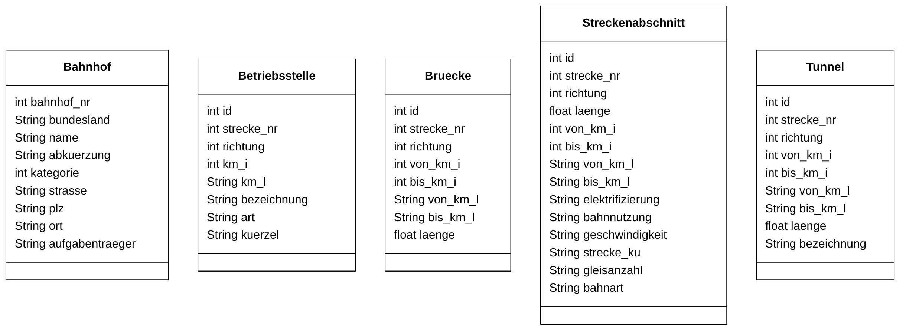

**Tabellenschema:** [](https://raw.githubusercontent.com/ValentinHerrmann/dbiu_databases/main/dbiu_databases/bahn.schema.png)

```text
Bahnhof(int b̲a̲h̲n̲h̲o̲f̲_̲n̲r̲, String bundesland, String name, String abkuerzung, int kategorie, String strasse, String plz, String ort, String aufgabentraeger)
Betriebsstelle(int i̲d̲, int strecke_nr, int richtung, int km_i, String km_l, String bezeichnung, String art, String kuerzel)
Bruecke(int i̲d̲, int strecke_nr, int richtung, int von_km_i, int bis_km_i, String von_km_l, String bis_km_l, float laenge)
Streckenabschnitt(int i̲d̲, int strecke_nr, int richtung, float laenge, int von_km_i, int bis_km_i, String von_km_l, String bis_km_l, String elektrifizierung, String bahnnutzung, String geschwindigkeit, String strecke_ku, String gleisanzahl, String bahnart)
Tunnel(int i̲d̲, int strecke_nr, int richtung, int von_km_i, int bis_km_i, String von_km_l, String bis_km_l, float laenge, String bezeichnung)
```


#### Database in version: 2 - dbiu.bayern

**UML (m:n direkt):** [](https://raw.githubusercontent.com/ValentinHerrmann/dbiu_databases/main/dbiu_databases/bayern_mn.png) [](https://raw.githubusercontent.com/ValentinHerrmann/dbiu_databases/main/dbiu_databases/bayern_mn.pdf) [](https://raw.githubusercontent.com/ValentinHerrmann/dbiu_databases/main/dbiu_databases/bayern_mn_portrait.png) [](https://raw.githubusercontent.com/ValentinHerrmann/dbiu_databases/main/dbiu_databases/bayern_mn_portrait.pdf)

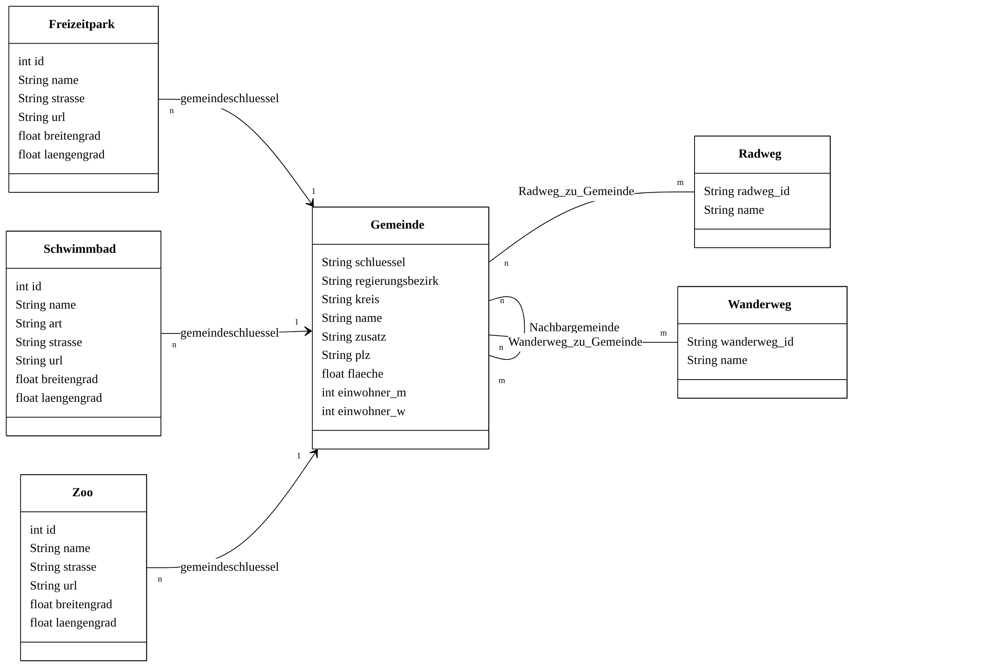

**UML (m:n mit Beziehungstabelle):** [](https://raw.githubusercontent.com/ValentinHerrmann/dbiu_databases/main/dbiu_databases/bayern_1n-1n.png) [](https://raw.githubusercontent.com/ValentinHerrmann/dbiu_databases/main/dbiu_databases/bayern_1n-1n.pdf) [](https://raw.githubusercontent.com/ValentinHerrmann/dbiu_databases/main/dbiu_databases/bayern_1n-1n_portrait.png) [](https://raw.githubusercontent.com/ValentinHerrmann/dbiu_databases/main/dbiu_databases/bayern_1n-1n_portrait.pdf)

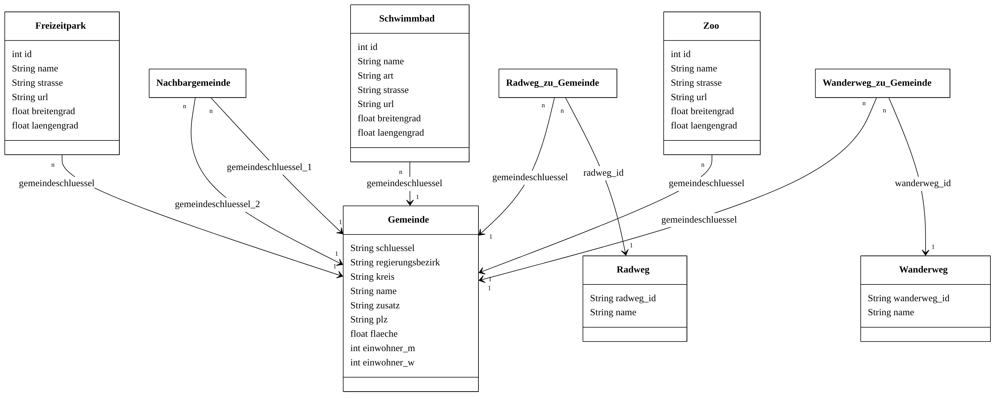

**Tabellenschema:** [](https://raw.githubusercontent.com/ValentinHerrmann/dbiu_databases/main/dbiu_databases/bayern.schema.png)

```text
Freizeitpark(int i̲d̲, String name, String g̣ẹṃẹịṇḍẹṣc̣ḥḷụẹṣṣẹḷ, String strasse, String url, float breitengrad, float laengengrad)
Gemeinde(String s̲c̲h̲l̲u̲e̲s̲s̲e̲l̲, String regierungsbezirk, String kreis, String name, String zusatz, String plz, float flaeche, int einwohner_m, int einwohner_w)
Nachbargemeinde(String g̲̣e̲̣m̲̣e̲̣i̲̣n̲̣d̲̣e̲̣s̲̣c̲̣h̲̣l̲̣u̲̣e̲̣s̲̣s̲̣e̲̣l̲̣_̲̣1̲̣, String g̲̣e̲̣m̲̣e̲̣i̲̣n̲̣d̲̣e̲̣s̲̣c̲̣h̲̣l̲̣u̲̣e̲̣s̲̣s̲̣e̲̣l̲̣_̲̣2̲̣)
Radweg(String r̲a̲d̲w̲e̲g̲_̲i̲d̲, String name)
Radweg_zu_Gemeinde(String r̲̣a̲̣d̲̣w̲̣e̲̣g̲̣_̲̣i̲̣d̲̣, String g̲̣e̲̣m̲̣e̲̣i̲̣n̲̣d̲̣e̲̣s̲̣c̲̣h̲̣l̲̣u̲̣e̲̣s̲̣s̲̣e̲̣l̲̣)
Schwimmbad(int i̲d̲, String name, String art, String g̣ẹṃẹịṇḍẹṣc̣ḥḷụẹṣṣẹḷ, String strasse, String url, float breitengrad, float laengengrad)
Wanderweg(String w̲a̲n̲d̲e̲r̲w̲e̲g̲_̲i̲d̲, String name)
Wanderweg_zu_Gemeinde(String w̲̣a̲̣n̲̣d̲̣e̲̣r̲̣w̲̣e̲̣g̲̣_̲̣i̲̣d̲̣, String g̲̣e̲̣m̲̣e̲̣i̲̣n̲̣d̲̣e̲̣s̲̣c̲̣h̲̣l̲̣u̲̣e̲̣s̲̣s̲̣e̲̣l̲̣)
Zoo(int i̲d̲, String name, String g̣ẹṃẹịṇḍẹṣc̣ḥḷụẹṣṣẹḷ, String strasse, String url, float breitengrad, float laengengrad)
```


#### Database in version: 3 - dbiu.bundestag

**UML:** [](https://raw.githubusercontent.com/ValentinHerrmann/dbiu_databases/main/dbiu_databases/bundestag.png) [](https://raw.githubusercontent.com/ValentinHerrmann/dbiu_databases/main/dbiu_databases/bundestag.pdf) [](https://raw.githubusercontent.com/ValentinHerrmann/dbiu_databases/main/dbiu_databases/bundestag_portrait.png) [](https://raw.githubusercontent.com/ValentinHerrmann/dbiu_databases/main/dbiu_databases/bundestag_portrait.pdf)

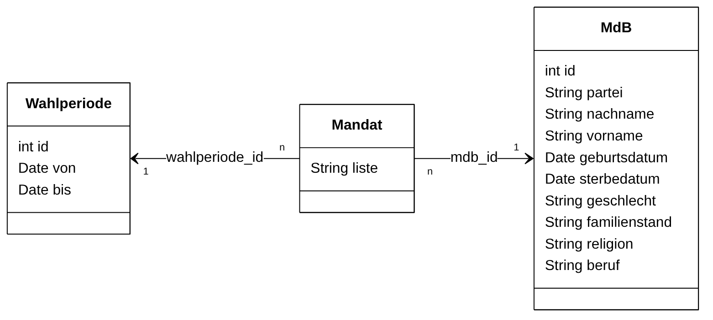

**Tabellenschema:** [](https://raw.githubusercontent.com/ValentinHerrmann/dbiu_databases/main/dbiu_databases/bundestag.schema.png)

```text
Mandat(int m̲̣d̲̣b̲̣_̲̣i̲̣d̲̣, int w̲̣a̲̣h̲̣l̲̣p̲̣e̲̣r̲̣i̲̣o̲̣d̲̣e̲̣_̲̣i̲̣d̲̣, String liste)
MdB(int i̲d̲, String partei, String nachname, String vorname, Date geburtsdatum, Date sterbedatum, String geschlecht, String familienstand, String religion, String beruf)
Wahlperiode(int i̲d̲, Date von, Date bis)
```


#### Database in version: 4 - dbiu.bundestag_einfach

**UML:** [](https://raw.githubusercontent.com/ValentinHerrmann/dbiu_databases/main/dbiu_databases/bundestag_einfach.png) [](https://raw.githubusercontent.com/ValentinHerrmann/dbiu_databases/main/dbiu_databases/bundestag_einfach.pdf)

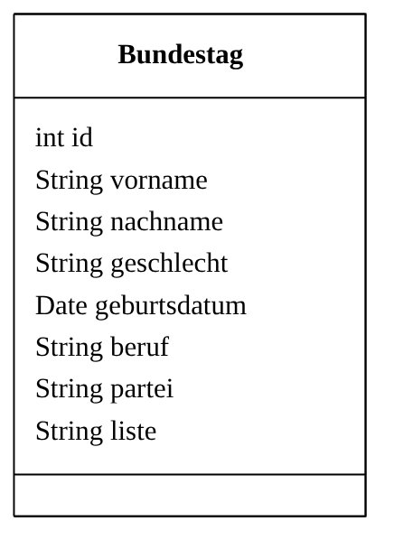

**Tabellenschema:** [](https://raw.githubusercontent.com/ValentinHerrmann/dbiu_databases/main/dbiu_databases/bundestag_einfach.schema.png)

```text
Bundestag(int i̲d̲, String vorname, String nachname, String geschlecht, Date geburtsdatum, String beruf, String partei, String liste)
```


#### Database in version: 5 - dbiu.film_fernsehen

**UML:** [](https://raw.githubusercontent.com/ValentinHerrmann/dbiu_databases/main/dbiu_databases/film_fernsehen.png) [](https://raw.githubusercontent.com/ValentinHerrmann/dbiu_databases/main/dbiu_databases/film_fernsehen.pdf) [](https://raw.githubusercontent.com/ValentinHerrmann/dbiu_databases/main/dbiu_databases/film_fernsehen_portrait.png) [](https://raw.githubusercontent.com/ValentinHerrmann/dbiu_databases/main/dbiu_databases/film_fernsehen_portrait.pdf)

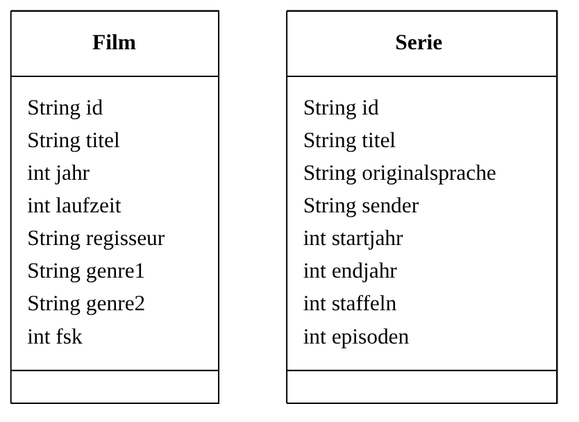

**Tabellenschema:** [](https://raw.githubusercontent.com/ValentinHerrmann/dbiu_databases/main/dbiu_databases/film_fernsehen.schema.png)

```text
Film(String i̲d̲, String titel, int jahr, int laufzeit, String regisseur, String genre1, String genre2, int fsk)
Serie(String i̲d̲, String titel, String originalsprache, String sender, int startjahr, int endjahr, int staffeln, int episoden)
```


#### Database in version: 6 - dbiu.haushaltsausstattung

**UML:** [](https://raw.githubusercontent.com/ValentinHerrmann/dbiu_databases/main/dbiu_databases/haushaltsausstattung.png) [](https://raw.githubusercontent.com/ValentinHerrmann/dbiu_databases/main/dbiu_databases/haushaltsausstattung.pdf)

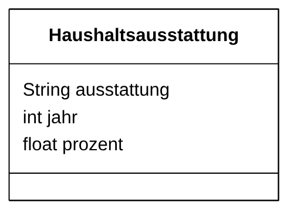

**Tabellenschema:** [](https://raw.githubusercontent.com/ValentinHerrmann/dbiu_databases/main/dbiu_databases/haushaltsausstattung.schema.png)

```text
Haushaltsausstattung(String a̲u̲s̲s̲t̲a̲t̲t̲u̲n̲g̲, int j̲a̲h̲r̲, float prozent)
```


#### Database in version: 7 - dbiu.straftaten

**UML:** [](https://raw.githubusercontent.com/ValentinHerrmann/dbiu_databases/main/dbiu_databases/straftaten.png) [](https://raw.githubusercontent.com/ValentinHerrmann/dbiu_databases/main/dbiu_databases/straftaten.pdf) [](https://raw.githubusercontent.com/ValentinHerrmann/dbiu_databases/main/dbiu_databases/straftaten_portrait.png) [](https://raw.githubusercontent.com/ValentinHerrmann/dbiu_databases/main/dbiu_databases/straftaten_portrait.pdf)

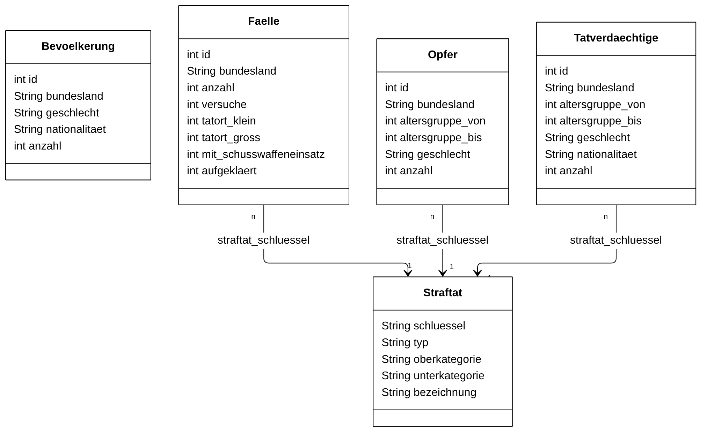

**Tabellenschema:** [](https://raw.githubusercontent.com/ValentinHerrmann/dbiu_databases/main/dbiu_databases/straftaten.schema.png)

```text
Straftat(String s̲c̲h̲l̲u̲e̲s̲s̲e̲l̲, String typ, String oberkategorie, String unterkategorie, String bezeichnung)
Bevoelkerung(int i̲d̲, String bundesland, String geschlecht, String nationalitaet, int anzahl)
Faelle(int i̲d̲, String ṣṭṛạf̣ṭạṭ_̣ṣc̣ḥḷụẹṣṣẹḷ, String bundesland, int anzahl, int versuche, int tatort_klein, int tatort_gross, int mit_schusswaffeneinsatz, int aufgeklaert)
Opfer(int i̲d̲, String ṣṭṛạf̣ṭạṭ_̣ṣc̣ḥḷụẹṣṣẹḷ, String bundesland, int altersgruppe_von, int altersgruppe_bis, String geschlecht, int anzahl)
Tatverdaechtige(int i̲d̲, String ṣṭṛạf̣ṭạṭ_̣ṣc̣ḥḷụẹṣṣẹḷ, String bundesland, int altersgruppe_von, int altersgruppe_bis, String geschlecht, String nationalitaet, int anzahl)
```


#### Database in version: 8 - dbiu.straftaten_einfach

**UML:** [](https://raw.githubusercontent.com/ValentinHerrmann/dbiu_databases/main/dbiu_databases/straftaten_einfach.png) [](https://raw.githubusercontent.com/ValentinHerrmann/dbiu_databases/main/dbiu_databases/straftaten_einfach.pdf)

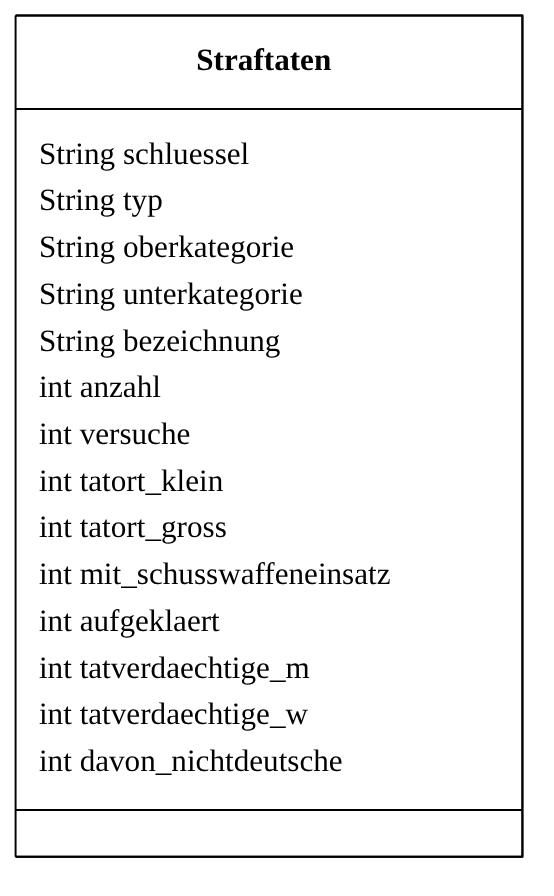

**Tabellenschema:** [](https://raw.githubusercontent.com/ValentinHerrmann/dbiu_databases/main/dbiu_databases/straftaten_einfach.schema.png)

```text
Straftaten(String s̲c̲h̲l̲u̲e̲s̲s̲e̲l̲, String typ, String oberkategorie, String unterkategorie, String bezeichnung, int anzahl, int versuche, int tatort_klein, int tatort_gross, int mit_schusswaffeneinsatz, int aufgeklaert, int tatverdaechtige_m, int tatverdaechtige_w, int davon_nichtdeutsche)
```


#### Database in version: 9 - dbiu.kunstsammlung

**UML (m:n direkt):** [](https://raw.githubusercontent.com/ValentinHerrmann/dbiu_databases/main/dbiu_databases/kunstsammlung_mn.png) [](https://raw.githubusercontent.com/ValentinHerrmann/dbiu_databases/main/dbiu_databases/kunstsammlung_mn.pdf) [](https://raw.githubusercontent.com/ValentinHerrmann/dbiu_databases/main/dbiu_databases/kunstsammlung_mn_portrait.png) [](https://raw.githubusercontent.com/ValentinHerrmann/dbiu_databases/main/dbiu_databases/kunstsammlung_mn_portrait.pdf)

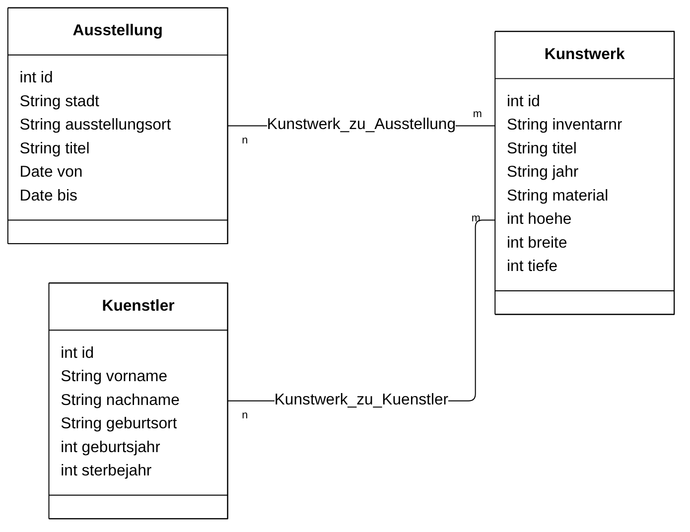

**UML (m:n mit Beziehungstabelle):** [](https://raw.githubusercontent.com/ValentinHerrmann/dbiu_databases/main/dbiu_databases/kunstsammlung_1n-1n.png) [](https://raw.githubusercontent.com/ValentinHerrmann/dbiu_databases/main/dbiu_databases/kunstsammlung_1n-1n.pdf) [](https://raw.githubusercontent.com/ValentinHerrmann/dbiu_databases/main/dbiu_databases/kunstsammlung_1n-1n_portrait.png) [](https://raw.githubusercontent.com/ValentinHerrmann/dbiu_databases/main/dbiu_databases/kunstsammlung_1n-1n_portrait.pdf)

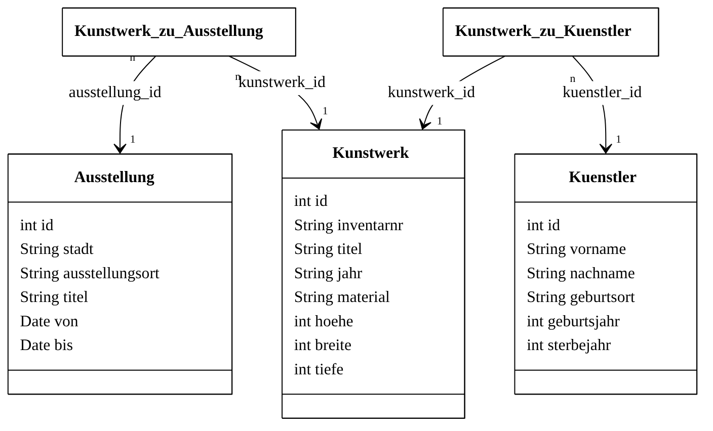

**Tabellenschema:** [](https://raw.githubusercontent.com/ValentinHerrmann/dbiu_databases/main/dbiu_databases/kunstsammlung.schema.png)

```text
Ausstellung(int i̲d̲, String stadt, String ausstellungsort, String titel, Date von, Date bis)
Kuenstler(int i̲d̲, String vorname, String nachname, String geburtsort, int geburtsjahr, int sterbejahr)
Kunstwerk(int i̲d̲, String inventarnr, String titel, String jahr, String material, int hoehe, int breite, int tiefe)
Kunstwerk_zu_Ausstellung(int k̲̣u̲̣n̲̣s̲̣t̲̣w̲̣e̲̣r̲̣k̲̣_̲̣i̲̣d̲̣, int a̲̣u̲̣s̲̣s̲̣t̲̣e̲̣l̲̣l̲̣u̲̣n̲̣g̲̣_̲̣i̲̣d̲̣)
Kunstwerk_zu_Kuenstler(int k̲̣u̲̣n̲̣s̲̣t̲̣w̲̣e̲̣r̲̣k̲̣_̲̣i̲̣d̲̣, int k̲̣u̲̣e̲̣n̲̣s̲̣t̲̣l̲̣e̲̣r̲̣_̲̣i̲̣d̲̣)
```


#### Database in version: 10 - dbiu.ladepunkte

**UML:** [](https://raw.githubusercontent.com/ValentinHerrmann/dbiu_databases/main/dbiu_databases/ladepunkte.png) [](https://raw.githubusercontent.com/ValentinHerrmann/dbiu_databases/main/dbiu_databases/ladepunkte.pdf) [](https://raw.githubusercontent.com/ValentinHerrmann/dbiu_databases/main/dbiu_databases/ladepunkte_portrait.png) [](https://raw.githubusercontent.com/ValentinHerrmann/dbiu_databases/main/dbiu_databases/ladepunkte_portrait.pdf)

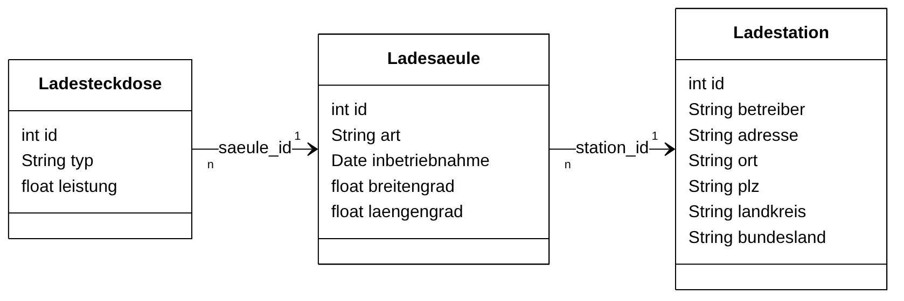

**Tabellenschema:** [](https://raw.githubusercontent.com/ValentinHerrmann/dbiu_databases/main/dbiu_databases/ladepunkte.schema.png)

```text
Ladesaeule(int i̲d̲, int ṣṭạṭịọṇ_̣ịḍ, String art, Date inbetriebnahme, float breitengrad, float laengengrad)
Ladestation(int i̲d̲, String betreiber, String adresse, String ort, String plz, String landkreis, String bundesland)
Ladesteckdose(int i̲d̲, int ṣạẹụḷẹ_̣ịḍ, String typ, float leistung)
```


#### Database in version: 11 - dbiu.laenderspiele

**UML:** [](https://raw.githubusercontent.com/ValentinHerrmann/dbiu_databases/main/dbiu_databases/laenderspiele.png) [](https://raw.githubusercontent.com/ValentinHerrmann/dbiu_databases/main/dbiu_databases/laenderspiele.pdf)

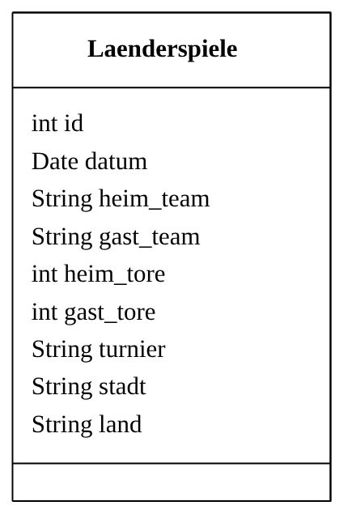

**Tabellenschema:** [](https://raw.githubusercontent.com/ValentinHerrmann/dbiu_databases/main/dbiu_databases/laenderspiele.schema.png)

```text
Laenderspiele(int i̲d̲, Date datum, String heim_team, String gast_team, int heim_tore, int gast_tore, String turnier, String stadt, String land)
```


#### Database in version: 12 - dbiu.lebensmittel

**UML:** [](https://raw.githubusercontent.com/ValentinHerrmann/dbiu_databases/main/dbiu_databases/lebensmittel.png) [](https://raw.githubusercontent.com/ValentinHerrmann/dbiu_databases/main/dbiu_databases/lebensmittel.pdf)

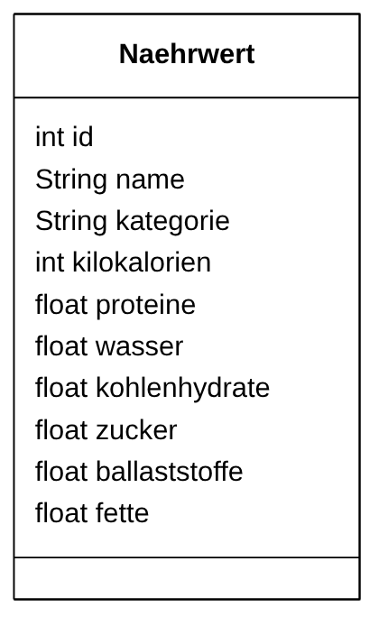

**Tabellenschema:** [](https://raw.githubusercontent.com/ValentinHerrmann/dbiu_databases/main/dbiu_databases/lebensmittel.schema.png)

```text
Naehrwert(int i̲d̲, String name, String kategorie, int kilokalorien, float proteine, float wasser, float kohlenhydrate, float zucker, float ballaststoffe, float fette)
```


#### Database in version: 13 - dbiu.schulstatistik

**UML:** [](https://raw.githubusercontent.com/ValentinHerrmann/dbiu_databases/main/dbiu_databases/schulstatistik.png) [](https://raw.githubusercontent.com/ValentinHerrmann/dbiu_databases/main/dbiu_databases/schulstatistik.pdf)

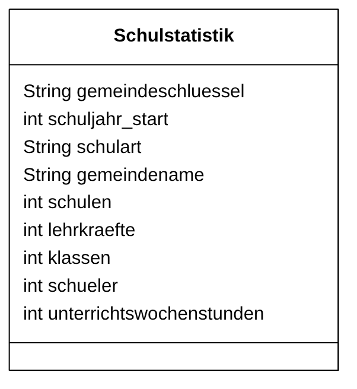

**Tabellenschema:** [](https://raw.githubusercontent.com/ValentinHerrmann/dbiu_databases/main/dbiu_databases/schulstatistik.schema.png)

```text
Schulstatistik(String g̲e̲m̲e̲i̲n̲d̲e̲s̲c̲h̲l̲u̲e̲s̲s̲e̲l̲, int s̲c̲h̲u̲l̲j̲a̲h̲r̲_̲s̲t̲a̲r̲t̲, String s̲c̲h̲u̲l̲a̲r̲t̲, String gemeindename, int schulen, int lehrkraefte, int klassen, int schueler, int unterrichtswochenstunden)
```


#### Database in version: 14 - dbiu.studierende

**UML:** [](https://raw.githubusercontent.com/ValentinHerrmann/dbiu_databases/main/dbiu_databases/studierende.png) [](https://raw.githubusercontent.com/ValentinHerrmann/dbiu_databases/main/dbiu_databases/studierende.pdf) [](https://raw.githubusercontent.com/ValentinHerrmann/dbiu_databases/main/dbiu_databases/studierende_portrait.png) [](https://raw.githubusercontent.com/ValentinHerrmann/dbiu_databases/main/dbiu_databases/studierende_portrait.pdf)

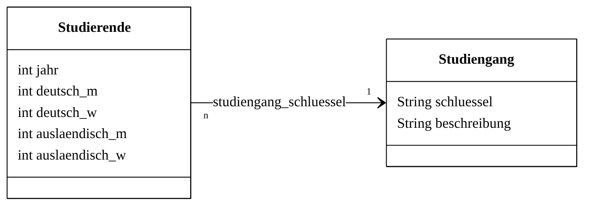

**Tabellenschema:** [](https://raw.githubusercontent.com/ValentinHerrmann/dbiu_databases/main/dbiu_databases/studierende.schema.png)

```text
Studiengang(String s̲c̲h̲l̲u̲e̲s̲s̲e̲l̲, String beschreibung)
Studierende(String s̲̣t̲̣u̲̣d̲̣i̲̣e̲̣n̲̣g̲̣a̲̣n̲̣g̲̣_̲̣s̲̣c̲̣h̲̣l̲̣u̲̣e̲̣s̲̣s̲̣e̲̣l̲̣, int j̲a̲h̲r̲, int deutsch_m, int deutsch_w, int auslaendisch_m, int auslaendisch_w)
```


#### Database in version: 15 - dbiu.unfallstatistik

**UML:** [](https://raw.githubusercontent.com/ValentinHerrmann/dbiu_databases/main/dbiu_databases/unfallstatistik.png) [](https://raw.githubusercontent.com/ValentinHerrmann/dbiu_databases/main/dbiu_databases/unfallstatistik.pdf)

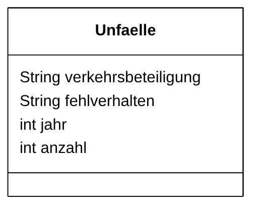

**Tabellenschema:** [](https://raw.githubusercontent.com/ValentinHerrmann/dbiu_databases/main/dbiu_databases/unfallstatistik.schema.png)

```text
Unfaelle(String v̲e̲r̲k̲e̲h̲r̲s̲b̲e̲t̲e̲i̲l̲i̲g̲u̲n̲g̲, String f̲e̲h̲l̲v̲e̲r̲h̲a̲l̲t̲e̲n̲, int j̲a̲h̲r̲, int anzahl)
```


#### Database in version: 16 - dbiu.videospiele_einfach

**UML:** [](https://raw.githubusercontent.com/ValentinHerrmann/dbiu_databases/main/dbiu_databases/videospiele_einfach.png) [](https://raw.githubusercontent.com/ValentinHerrmann/dbiu_databases/main/dbiu_databases/videospiele_einfach.pdf)

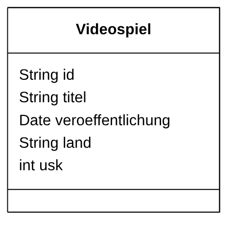

**Tabellenschema:** [](https://raw.githubusercontent.com/ValentinHerrmann/dbiu_databases/main/dbiu_databases/videospiele_einfach.schema.png)

```text
Videospiel(String i̲d̲, String titel, Date veroeffentlichung, String land, int usk)
```


#### Database in version: 17 - dbiu.videospiele

**UML (m:n direkt):** [](https://raw.githubusercontent.com/ValentinHerrmann/dbiu_databases/main/dbiu_databases/videospiele_mn.png) [](https://raw.githubusercontent.com/ValentinHerrmann/dbiu_databases/main/dbiu_databases/videospiele_mn.pdf)

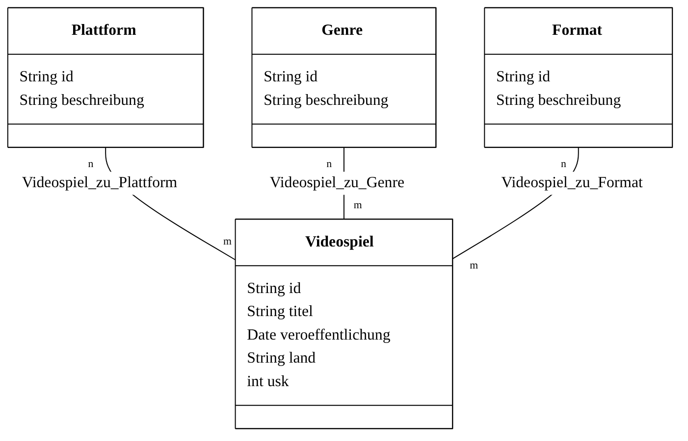

**UML (m:n mit Beziehungstabelle):** [](https://raw.githubusercontent.com/ValentinHerrmann/dbiu_databases/main/dbiu_databases/videospiele_1n-1n.png) [](https://raw.githubusercontent.com/ValentinHerrmann/dbiu_databases/main/dbiu_databases/videospiele_1n-1n.pdf)

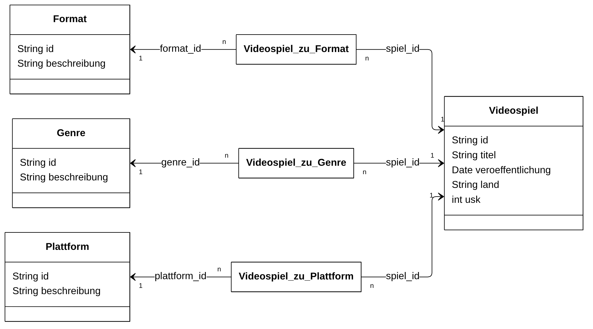

**Tabellenschema:** [](https://raw.githubusercontent.com/ValentinHerrmann/dbiu_databases/main/dbiu_databases/videospiele.schema.png)

```text
Format(String i̲d̲, String beschreibung)
Genre(String i̲d̲, String beschreibung)
Plattform(String i̲d̲, String beschreibung)
Videospiel(String i̲d̲, String titel, Date veroeffentlichung, String land, int usk)
Videospiel_zu_Plattform(String s̲̣p̲̣i̲̣e̲̣l̲̣_̲̣i̲̣d̲̣, String p̲̣l̲̣a̲̣t̲̣t̲̣f̲̣o̲̣r̲̣m̲̣_̲̣i̲̣d̲̣)
Videospiel_zu_Genre(String s̲̣p̲̣i̲̣e̲̣l̲̣_̲̣i̲̣d̲̣, String g̲̣e̲̣n̲̣r̲̣e̲̣_̲̣i̲̣d̲̣)
Videospiel_zu_Format(String s̲̣p̲̣i̲̣e̲̣l̲̣_̲̣i̲̣d̲̣, String f̲̣o̲̣r̲̣m̲̣a̲̣t̲̣_̲̣i̲̣d̲̣)
```


#### Database in version: 18 - dbiu.wetterdaten

**UML:** [](https://raw.githubusercontent.com/ValentinHerrmann/dbiu_databases/main/dbiu_databases/wetterdaten.png) [](https://raw.githubusercontent.com/ValentinHerrmann/dbiu_databases/main/dbiu_databases/wetterdaten.pdf)

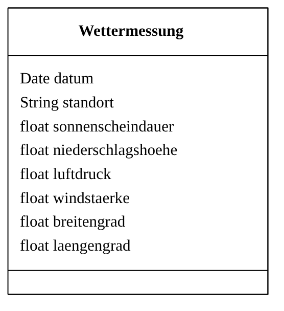

**Tabellenschema:** [](https://raw.githubusercontent.com/ValentinHerrmann/dbiu_databases/main/dbiu_databases/wetterdaten.schema.png)

```text
Wettermessung(Date d̲a̲t̲u̲m̲, String s̲t̲a̲n̲d̲o̲r̲t̲, float sonnenscheindauer, float niederschlagshoehe, float luftdruck, float windstaerke, float breitengrad, float laengengrad)
```


#### Database in version: 19 - dbiu.terra

**UML (m:n direkt):** [](https://raw.githubusercontent.com/ValentinHerrmann/dbiu_databases/main/dbiu_databases/terra_mn.png) [](https://raw.githubusercontent.com/ValentinHerrmann/dbiu_databases/main/dbiu_databases/terra_mn.pdf) [](https://raw.githubusercontent.com/ValentinHerrmann/dbiu_databases/main/dbiu_databases/terra_mn_portrait.png) [](https://raw.githubusercontent.com/ValentinHerrmann/dbiu_databases/main/dbiu_databases/terra_mn_portrait.pdf)

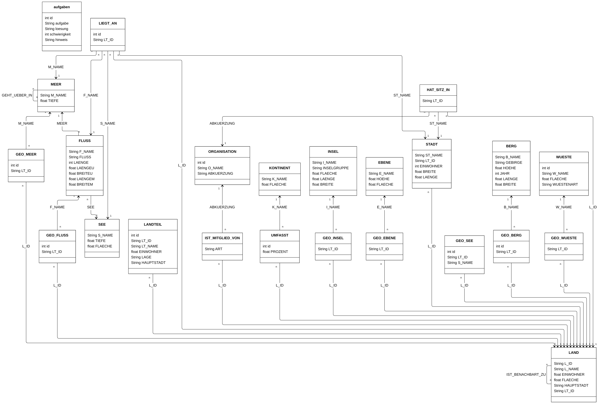

**UML (m:n mit Beziehungstabelle):** [](https://raw.githubusercontent.com/ValentinHerrmann/dbiu_databases/main/dbiu_databases/terra_1n-1n.png) [](https://raw.githubusercontent.com/ValentinHerrmann/dbiu_databases/main/dbiu_databases/terra_1n-1n.pdf) [](https://raw.githubusercontent.com/ValentinHerrmann/dbiu_databases/main/dbiu_databases/terra_1n-1n_portrait.png) [](https://raw.githubusercontent.com/ValentinHerrmann/dbiu_databases/main/dbiu_databases/terra_1n-1n_portrait.pdf)

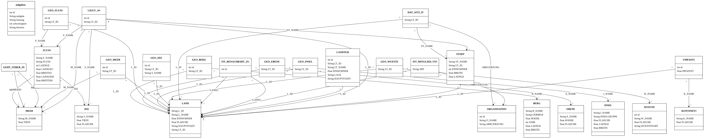

**Tabellenschema:** [](https://raw.githubusercontent.com/ValentinHerrmann/dbiu_databases/main/dbiu_databases/terra.schema.png)

```text
aufgaben(int i̲d̲, String aufgabe, String loesung, int schwierigkeit, String hinweis)
BERG(String B̲_̲N̲A̲M̲E̲, String GEBIRGE, float HOEHE, int JAHR, float LAENGE, float BREITE)
EBENE(String E̲_̲N̲A̲M̲E̲, float HOEHE, float FLAECHE)
FLUSS(String F̲_̲N̲A̲M̲E̲, String FLUSS, String ṢẸẸ, String ṂẸẸṚ, int LAENGE, float LAENGEU, float BREITEU, float LAENGEM, float BREITEM)
GEHT_UEBER_IN(String ṂẸẸṚ1̣, String ṂẸẸṚ2̣)
GEO_BERG(int i̲d̲, String Ḷ_̣ỊḌ, String LT_ID, String Ḅ_̣ṆẠṂẸ)
GEO_EBENE(String LT_ID, String Ḷ_̣ỊḌ, String Ẹ_̣ṆẠṂẸ)
GEO_FLUSS(int i̲d̲, String Ḷ_̣ỊḌ, String LT_ID, String F̣_̣ṆẠṂẸ)
GEO_INSEL(String LT_ID, String Ḷ_̣ỊḌ, String Ị_̣ṆẠṂẸ)
GEO_MEER(int i̲d̲, String LT_ID, String Ḷ_̣ỊḌ, String Ṃ_̣ṆẠṂẸ)
GEO_SEE(int i̲d̲, String LT_ID, String Ḷ_̣ỊḌ, String S_NAME)
GEO_WUESTE(String LT_ID, String Ḷ_̣ỊḌ, String Ẉ_̣ṆẠṂẸ)
HAT_SITZ_IN(String ṢṬ_̣ṆẠṂẸ, String LT_ID, String Ḷ_̣ỊḌ, String ẠḄḲỤẸṚẒỤṆG̣)
INSEL(String I̲_̲N̲A̲M̲E̲, String INSELGRUPPE, float FLAECHE, float LAENGE, float BREITE)
IST_BENACHBART_ZU(int i̲d̲, String ḶẠṆḌ1̣, String ḶẠṆḌ2̣)
IST_MITGLIED_VON(String Ḷ_̣ỊḌ, String ẠḄḲỤẸṚẒỤṆG̣, String ART)
KONTINENT(String K̲_̲N̲A̲M̲E̲, float FLAECHE)
LAND(String L̲_̲I̲D̲, String L_NAME, float EINWOHNER, float FLAECHE, String HAUPTSTADT, String LT_ID)
LANDTEIL(int i̲d̲, String LT_ID, String Ḷ_̣ỊḌ, String LT_NAME, float EINWOHNER, String LAGE, String HAUPTSTADT)
LIEGT_AN(int i̲d̲, String ṢṬ_̣ṆẠṂẸ, String LT_ID, String Ḷ_̣ỊḌ, String F̣_̣ṆẠṂẸ, String Ṣ_̣ṆẠṂẸ, String Ṃ_̣ṆẠṂẸ)
MEER(String M̲_̲N̲A̲M̲E̲, float TIEFE)
ORGANISATION(int i̲d̲, String O_NAME, String ABKUERZUNG)
SEE(String S̲_̲N̲A̲M̲E̲, float TIEFE, float FLAECHE)
STADT(String S̲T̲_̲N̲A̲M̲E̲, String Ḷ_̣ỊḌ, String LT_ID, int EINWOHNER, float BREITE, float LAENGE)
UMFASST(int i̲d̲, String Ḷ_̣ỊḌ, String Ḳ_̣ṆẠṂẸ, float PROZENT)
WUESTE(int i̲d̲, String W_NAME, float FLAECHE, String WUESTENART)
```


#### Database in version: 20 - dbiu.chinook

**UML (m:n direkt):** [](https://raw.githubusercontent.com/ValentinHerrmann/dbiu_databases/main/dbiu_databases/chinook_mn.png) [](https://raw.githubusercontent.com/ValentinHerrmann/dbiu_databases/main/dbiu_databases/chinook_mn.pdf) [](https://raw.githubusercontent.com/ValentinHerrmann/dbiu_databases/main/dbiu_databases/chinook_mn_portrait.png) [](https://raw.githubusercontent.com/ValentinHerrmann/dbiu_databases/main/dbiu_databases/chinook_mn_portrait.pdf)

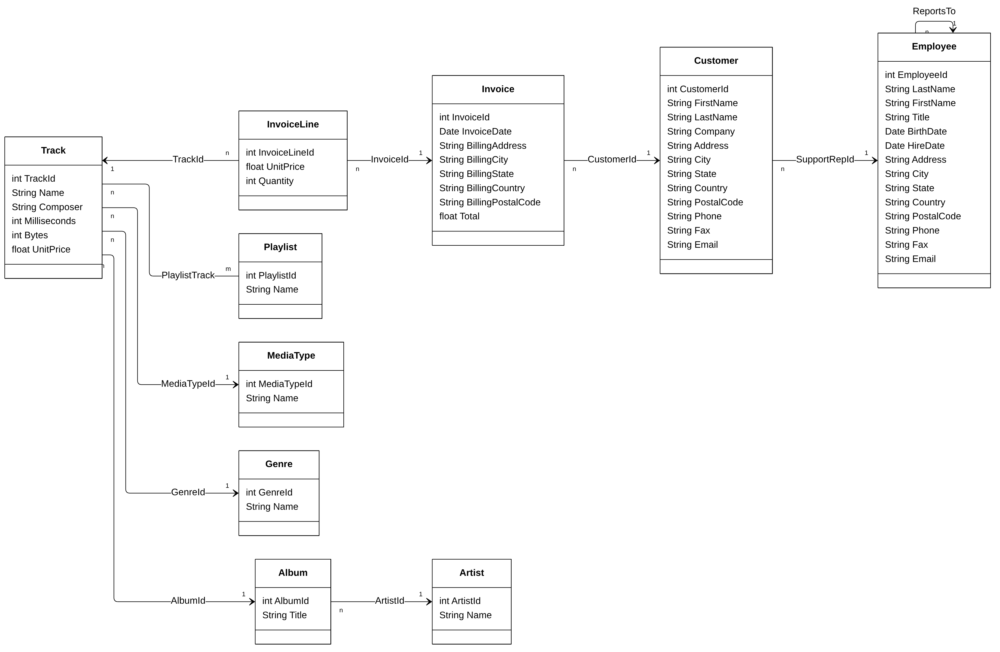

**UML (m:n mit Beziehungstabelle):** [](https://raw.githubusercontent.com/ValentinHerrmann/dbiu_databases/main/dbiu_databases/chinook_1n-1n.png) [](https://raw.githubusercontent.com/ValentinHerrmann/dbiu_databases/main/dbiu_databases/chinook_1n-1n.pdf) [](https://raw.githubusercontent.com/ValentinHerrmann/dbiu_databases/main/dbiu_databases/chinook_1n-1n_portrait.png) [](https://raw.githubusercontent.com/ValentinHerrmann/dbiu_databases/main/dbiu_databases/chinook_1n-1n_portrait.pdf)

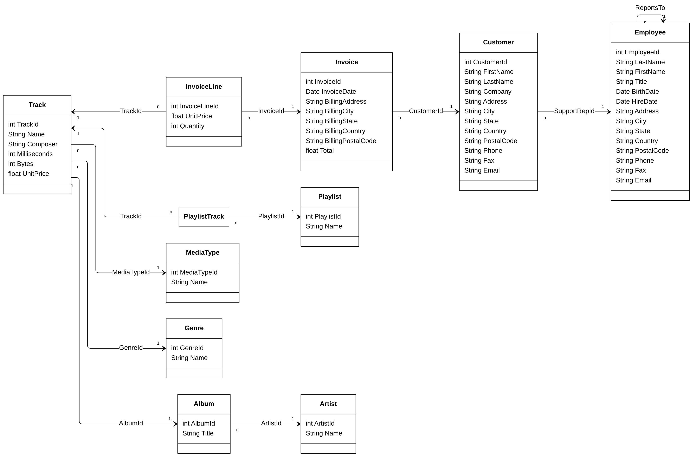

**Tabellenschema:** [](https://raw.githubusercontent.com/ValentinHerrmann/dbiu_databases/main/dbiu_databases/chinook.schema.png)

```text
Album(int A̲l̲b̲u̲m̲I̲d̲, String Title, int ẠṛṭịṣṭỊḍ)
Artist(int A̲r̲t̲i̲s̲t̲I̲d̲, String Name)
Customer(int C̲u̲s̲t̲o̲m̲e̲r̲I̲d̲, String FirstName, String LastName, String Company, String Address, String City, String State, String Country, String PostalCode, String Phone, String Fax, String Email, int Ṣụp̣p̣ọṛṭṚẹp̣Ịḍ)
Employee(int E̲m̲p̲l̲o̲y̲e̲e̲I̲d̲, String LastName, String FirstName, String Title, int Ṛẹp̣ọṛṭṣṬọ, Date BirthDate, Date HireDate, String Address, String City, String State, String Country, String PostalCode, String Phone, String Fax, String Email)
Genre(int G̲e̲n̲r̲e̲I̲d̲, String Name)
Invoice(int I̲n̲v̲o̲i̲c̲e̲I̲d̲, int C̣ụṣṭọṃẹṛỊḍ, Date InvoiceDate, String BillingAddress, String BillingCity, String BillingState, String BillingCountry, String BillingPostalCode, float Total)
InvoiceLine(int I̲n̲v̲o̲i̲c̲e̲L̲i̲n̲e̲I̲d̲, int Ịṇṿọịc̣ẹỊḍ, int Ṭṛạc̣ḳỊḍ, float UnitPrice, int Quantity)
MediaType(int M̲e̲d̲i̲a̲T̲y̲p̲e̲I̲d̲, String Name)
Playlist(int P̲l̲a̲y̲l̲i̲s̲t̲I̲d̲, String Name)
PlaylistTrack(int P̲̣l̲̣a̲̣y̲̣l̲̣i̲̣s̲̣t̲̣I̲̣d̲̣, int T̲̣r̲̣a̲̣c̲̣k̲̣I̲̣d̲̣)
Track(int T̲r̲a̲c̲k̲I̲d̲, String Name, int ẠḷḅụṃỊḍ, int ṂẹḍịạṬỵp̣ẹỊḍ, int G̣ẹṇṛẹỊḍ, String Composer, int Milliseconds, int Bytes, float UnitPrice)
```


#### Database in version: 21 - dbiu.bike

**UML:** [](https://raw.githubusercontent.com/ValentinHerrmann/dbiu_databases/main/dbiu_databases/bike.png) [](https://raw.githubusercontent.com/ValentinHerrmann/dbiu_databases/main/dbiu_databases/bike.pdf) [](https://raw.githubusercontent.com/ValentinHerrmann/dbiu_databases/main/dbiu_databases/bike_portrait.png) [](https://raw.githubusercontent.com/ValentinHerrmann/dbiu_databases/main/dbiu_databases/bike_portrait.pdf)

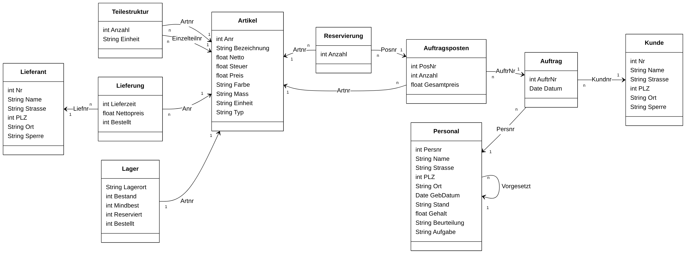

**Tabellenschema:** [](https://raw.githubusercontent.com/ValentinHerrmann/dbiu_databases/main/dbiu_databases/bike.schema.png)

```text
Lieferant(int N̲r̲, String Name, String Strasse, int PLZ, String Ort, String Sperre)
Kunde(int N̲r̲, String Name, String Strasse, int PLZ, String Ort, String Sperre)
Personal(int P̲e̲r̲s̲n̲r̲, String Name, String Strasse, int PLZ, String Ort, Date GebDatum, String Stand, int Ṿọṛg̣ẹṣẹṭẓṭ, float Gehalt, String Beurteilung, String Aufgabe)
Artikel(int A̲n̲r̲, String Bezeichnung, float Netto, float Steuer, float Preis, String Farbe, String Mass, String Einheit, String Typ)
Lager(int A̲̣r̲̣t̲̣n̲̣r̲̣, String Lagerort, int Bestand, int Mindbest, int Reserviert, int Bestellt)
Lieferung(int A̲̣n̲̣r̲̣, int L̲̣i̲̣e̲̣f̲̣n̲̣r̲̣, int Lieferzeit, float Nettopreis, int Bestellt)
Teilestruktur(int A̲̣r̲̣t̲̣n̲̣r̲̣, int E̲̣i̲̣n̲̣z̲̣e̲̣l̲̣t̲̣e̲̣i̲̣l̲̣n̲̣r̲̣, int Anzahl, String Einheit)
Auftrag(int A̲u̲f̲t̲r̲N̲r̲, Date Datum, int Ḳụṇḍṇṛ, int P̣ẹṛṣṇṛ)
Auftragsposten(int P̲o̲s̲N̲r̲, int Ạụf̣ṭṛṆṛ, int Ạṛṭṇṛ, int Anzahl, float Gesamtpreis)
Reservierung(int P̲̣o̲̣s̲̣n̲̣r̲̣, int A̲̣r̲̣t̲̣n̲̣r̲̣, int Anzahl)
```


#### Database in version: 22 - dbiu.schule

**UML (m:n direkt):** [](https://raw.githubusercontent.com/ValentinHerrmann/dbiu_databases/main/dbiu_databases/schule_mn.png) [](https://raw.githubusercontent.com/ValentinHerrmann/dbiu_databases/main/dbiu_databases/schule_mn.pdf) [](https://raw.githubusercontent.com/ValentinHerrmann/dbiu_databases/main/dbiu_databases/schule_mn_portrait.png) [](https://raw.githubusercontent.com/ValentinHerrmann/dbiu_databases/main/dbiu_databases/schule_mn_portrait.pdf)

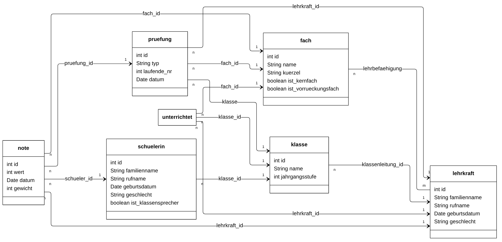

**UML (m:n mit Beziehungstabelle):** [](https://raw.githubusercontent.com/ValentinHerrmann/dbiu_databases/main/dbiu_databases/schule_1n-1n.png) [](https://raw.githubusercontent.com/ValentinHerrmann/dbiu_databases/main/dbiu_databases/schule_1n-1n.pdf) [](https://raw.githubusercontent.com/ValentinHerrmann/dbiu_databases/main/dbiu_databases/schule_1n-1n_portrait.png) [](https://raw.githubusercontent.com/ValentinHerrmann/dbiu_databases/main/dbiu_databases/schule_1n-1n_portrait.pdf)

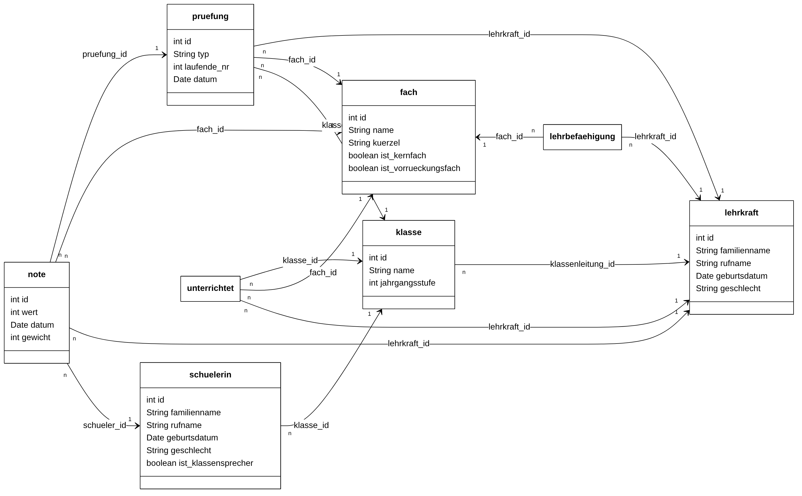

**Tabellenschema:** [](https://raw.githubusercontent.com/ValentinHerrmann/dbiu_databases/main/dbiu_databases/schule.schema.png)

```text
fach(int i̲d̲, String name, String kuerzel, boolean ist_kernfach, boolean ist_vorrueckungsfach)
klasse(int i̲d̲, String name, int jahrgangsstufe, int ḳḷạṣṣẹṇḷẹịṭụṇg̣_̣ịḍ)
lehrbefaehigung(int l̲̣e̲̣h̲̣r̲̣k̲̣r̲̣a̲̣f̲̣t̲̣_̲̣i̲̣d̲̣, int f̲̣a̲̣c̲̣h̲̣_̲̣i̲̣d̲̣)
lehrkraft(int i̲d̲, String familienname, String rufname, Date geburtsdatum, String geschlecht)
note(int i̲d̲, int wert, Date datum, int gewicht, int ṣc̣ḥụẹḷẹṛ_̣ịḍ, int ḷẹḥṛḳṛạf̣ṭ_̣ịḍ, int f̣ạc̣ḥ_̣ịḍ, int p̣ṛụẹf̣ụṇg̣_̣ịḍ)
pruefung(int i̲d̲, String typ, int laufende_nr, int ḳḷạṣṣẹ, Date datum, int f̣ạc̣ḥ_̣ịḍ, int ḷẹḥṛḳṛạf̣ṭ_̣ịḍ)
schuelerin(int i̲d̲, String familienname, String rufname, Date geburtsdatum, String geschlecht, boolean ist_klassensprecher, int ḳḷạṣṣẹ_̣ịḍ)
unterrichtet(int l̲̣e̲̣h̲̣r̲̣k̲̣r̲̣a̲̣f̲̣t̲̣_̲̣i̲̣d̲̣, int f̲̣a̲̣c̲̣h̲̣_̲̣i̲̣d̲̣, int k̲̣l̲̣a̲̣s̲̣s̲̣e̲̣_̲̣i̲̣d̲̣)
```


#### Database in version: 23 - dbiu.pokemon

**UML:** [](https://raw.githubusercontent.com/ValentinHerrmann/dbiu_databases/main/dbiu_databases/pokemon.png) [](https://raw.githubusercontent.com/ValentinHerrmann/dbiu_databases/main/dbiu_databases/pokemon.pdf) [](https://raw.githubusercontent.com/ValentinHerrmann/dbiu_databases/main/dbiu_databases/pokemon_portrait.png) [](https://raw.githubusercontent.com/ValentinHerrmann/dbiu_databases/main/dbiu_databases/pokemon_portrait.pdf)

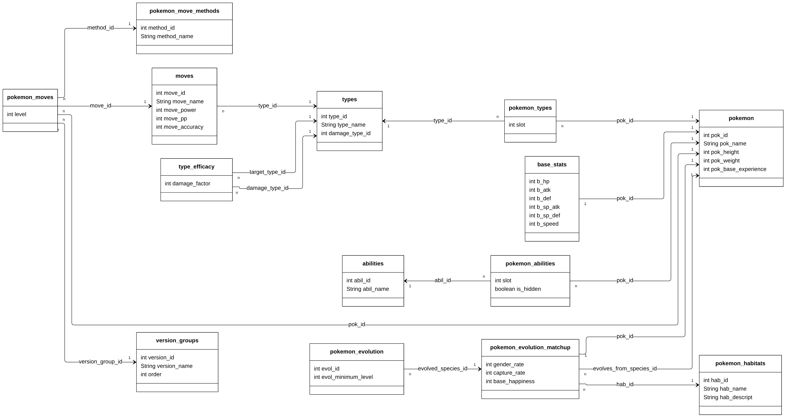

**Tabellenschema:** [](https://raw.githubusercontent.com/ValentinHerrmann/dbiu_databases/main/dbiu_databases/pokemon.schema.png)

```text
abilities(int a̲b̲i̲l̲_̲i̲d̲, String abil_name)
base_stats(int p̲̣o̲̣k̲̣_̲̣i̲̣d̲̣, int b_hp, int b_atk, int b_def, int b_sp_atk, int b_sp_def, int b_speed)
moves(int m̲o̲v̲e̲_̲i̲d̲, String move_name, int ṭỵp̣ẹ_̣ịḍ, int move_power, int move_pp, int move_accuracy)
pokemon(int p̲o̲k̲_̲i̲d̲, String pok_name, int pok_height, int pok_weight, int pok_base_experience)
pokemon_abilities(int p̲̣o̲̣k̲̣_̲̣i̲̣d̲̣, int s̲l̲o̲t̲, int ạḅịḷ_̣ịḍ, boolean is_hidden)
pokemon_evolution(int e̲v̲o̲l̲_̲i̲d̲, int ẹṿọḷṿẹḍ_̣ṣp̣ẹc̣ịẹṣ_̣ịḍ, int evol_minimum_level)
pokemon_evolution_matchup(int p̲̣o̲̣k̲̣_̲̣i̲̣d̲̣, int ẹṿọḷṿẹṣ_̣f̣ṛọṃ_̣ṣp̣ẹc̣ịẹṣ_̣ịḍ, int ḥạḅ_̣ịḍ, int gender_rate, int capture_rate, int base_happiness)
pokemon_habitats(int h̲a̲b̲_̲i̲d̲, String hab_name, String hab_descript)
pokemon_move_methods(int m̲e̲t̲h̲o̲d̲_̲i̲d̲, String method_name)
pokemon_moves(int p̲̣o̲̣k̲̣_̲̣i̲̣d̲̣, int v̲̣e̲̣r̲̣s̲̣i̲̣o̲̣n̲̣_̲̣g̲̣r̲̣o̲̣u̲̣p̲̣_̲̣i̲̣d̲̣, int m̲̣o̲̣v̲̣e̲̣_̲̣i̲̣d̲̣, int m̲̣e̲̣t̲̣h̲̣o̲̣d̲̣_̲̣i̲̣d̲̣, int l̲e̲v̲e̲l̲)
pokemon_types(int p̲̣o̲̣k̲̣_̲̣i̲̣d̲̣, int s̲l̲o̲t̲, int ṭỵp̣ẹ_̣ịḍ)
type_efficacy(int d̲̣a̲̣m̲̣a̲̣g̲̣e̲̣_̲̣t̲̣y̲̣p̲̣e̲̣_̲̣i̲̣d̲̣, int t̲̣a̲̣r̲̣g̲̣e̲̣t̲̣_̲̣t̲̣y̲̣p̲̣e̲̣_̲̣i̲̣d̲̣, int damage_factor)
types(int t̲y̲p̲e̲_̲i̲d̲, String type_name, int damage_type_id)
version_groups(int v̲e̲r̲s̲i̲o̲n̲_̲i̲d̲, String version_name, int order)
```


#### Database in version: 24 - dbiu.netflix

**UML:** [](https://raw.githubusercontent.com/ValentinHerrmann/dbiu_databases/main/dbiu_databases/netflix.png) [](https://raw.githubusercontent.com/ValentinHerrmann/dbiu_databases/main/dbiu_databases/netflix.pdf) [](https://raw.githubusercontent.com/ValentinHerrmann/dbiu_databases/main/dbiu_databases/netflix_portrait.png) [](https://raw.githubusercontent.com/ValentinHerrmann/dbiu_databases/main/dbiu_databases/netflix_portrait.pdf)

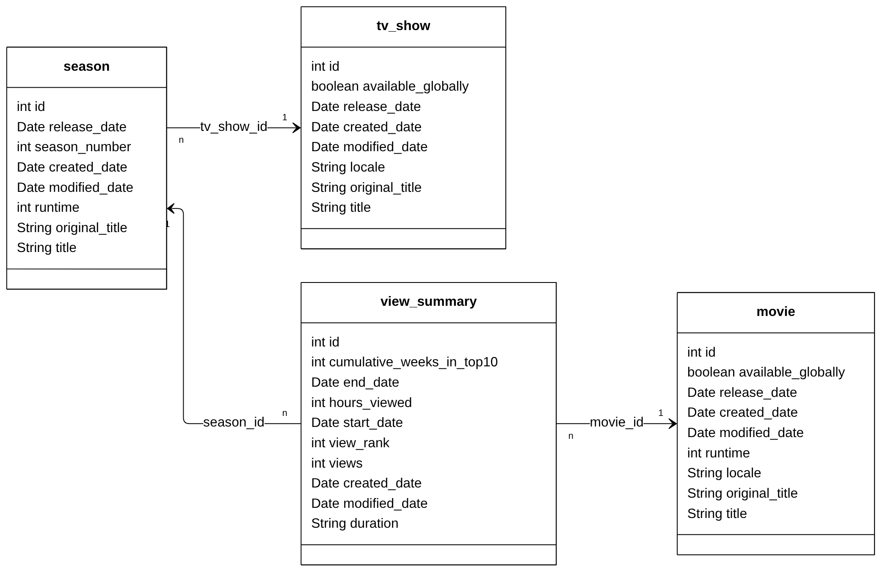

**Tabellenschema:** [](https://raw.githubusercontent.com/ValentinHerrmann/dbiu_databases/main/dbiu_databases/netflix.schema.png)

```text
movie(int i̲d̲, boolean available_globally, Date release_date, Date created_date, Date modified_date, int runtime, String locale, String original_title, String title)
tv_show(int i̲d̲, boolean available_globally, Date release_date, Date created_date, Date modified_date, String locale, String original_title, String title)
season(int i̲d̲, Date release_date, int season_number, Date created_date, Date modified_date, int runtime, int ṭṿ_̣ṣḥọẉ_̣ịḍ, String original_title, String title)
view_summary(int i̲d̲, int cumulative_weeks_in_top10, Date end_date, int hours_viewed, Date start_date, int view_rank, int views, Date created_date, Date modified_date, int ṃọṿịẹ_̣ịḍ, int ṣẹạṣọṇ_̣ịḍ, String duration)
```


#### Database in version: 25 - dbiu.geodaten

**UML:** [](https://raw.githubusercontent.com/ValentinHerrmann/dbiu_databases/main/dbiu_databases/geodaten.png) [](https://raw.githubusercontent.com/ValentinHerrmann/dbiu_databases/main/dbiu_databases/geodaten.pdf) [](https://raw.githubusercontent.com/ValentinHerrmann/dbiu_databases/main/dbiu_databases/geodaten_portrait.png) [](https://raw.githubusercontent.com/ValentinHerrmann/dbiu_databases/main/dbiu_databases/geodaten_portrait.pdf)

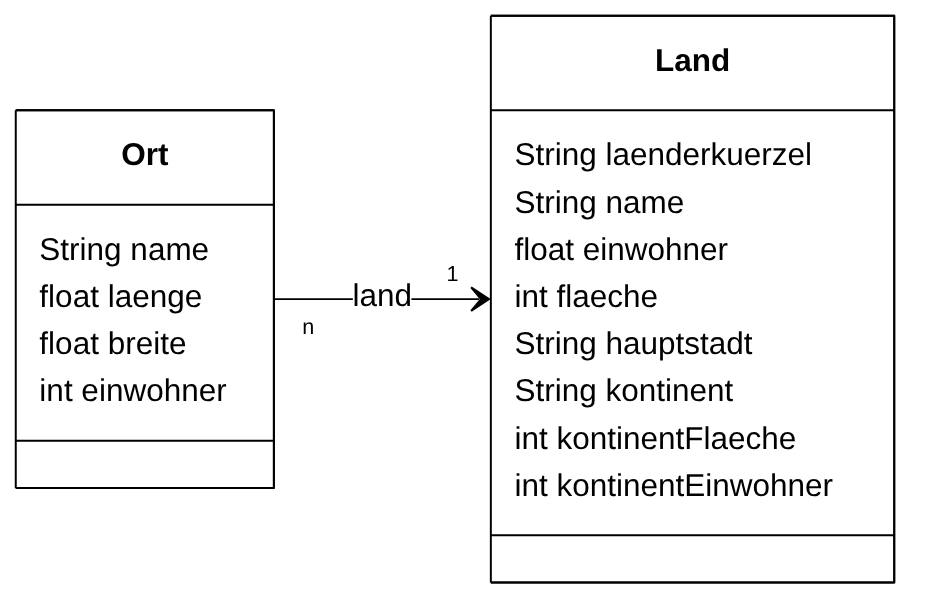

**Tabellenschema:** [](https://raw.githubusercontent.com/ValentinHerrmann/dbiu_databases/main/dbiu_databases/geodaten.schema.png)

```text
Land(String l̲a̲e̲n̲d̲e̲r̲k̲u̲e̲r̲z̲e̲l̲, String name, float einwohner, int flaeche, String hauptstadt, String kontinent, int kontinentFlaeche, int kontinentEinwohner)
Ort(String n̲a̲m̲e̲, float l̲a̲e̲n̲g̲e̲, float b̲r̲e̲i̲t̲e̲, String ḷạṇḍ, int einwohner)
```


#### Database in version: 26 - dbiu.olympia

**UML:** [](https://raw.githubusercontent.com/ValentinHerrmann/dbiu_databases/main/dbiu_databases/olympia.png) [](https://raw.githubusercontent.com/ValentinHerrmann/dbiu_databases/main/dbiu_databases/olympia.pdf)

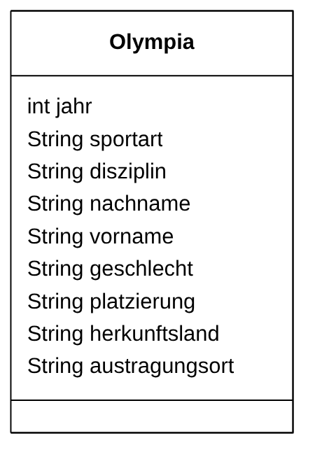

**Tabellenschema:** [](https://raw.githubusercontent.com/ValentinHerrmann/dbiu_databases/main/dbiu_databases/olympia.schema.png)

```text
Olympia(int j̲a̲h̲r̲, String s̲p̲o̲r̲t̲a̲r̲t̲, String d̲i̲s̲z̲i̲p̲l̲i̲n̲, String n̲a̲c̲h̲n̲a̲m̲e̲, String v̲o̲r̲n̲a̲m̲e̲, String geschlecht, String platzierung, String herkunftsland, String austragungsort)
```


#### Database in version: 27 - dbiu.passwoerter

**UML:** [](https://raw.githubusercontent.com/ValentinHerrmann/dbiu_databases/main/dbiu_databases/passwoerter.png) [](https://raw.githubusercontent.com/ValentinHerrmann/dbiu_databases/main/dbiu_databases/passwoerter.pdf) [](https://raw.githubusercontent.com/ValentinHerrmann/dbiu_databases/main/dbiu_databases/passwoerter_portrait.png) [](https://raw.githubusercontent.com/ValentinHerrmann/dbiu_databases/main/dbiu_databases/passwoerter_portrait.pdf)

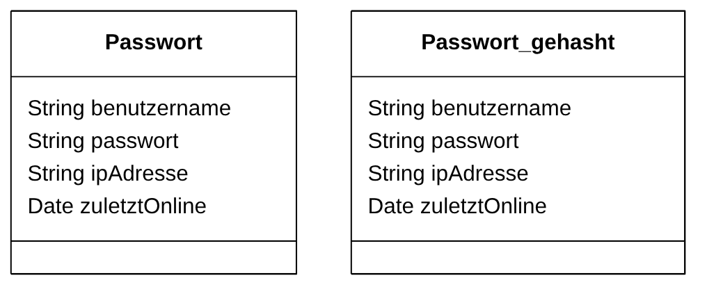

**Tabellenschema:** [](https://raw.githubusercontent.com/ValentinHerrmann/dbiu_databases/main/dbiu_databases/passwoerter.schema.png)

```text
Passwort(String benutzername, String passwort, String ipAdresse, Date zuletztOnline)
Passwort_gehasht(String benutzername, String passwort, String ipAdresse, Date zuletztOnline)
```


#### Database in version: 28 - dbiu.artikel

**UML:** [](https://raw.githubusercontent.com/ValentinHerrmann/dbiu_databases/main/dbiu_databases/artikel.png) [](https://raw.githubusercontent.com/ValentinHerrmann/dbiu_databases/main/dbiu_databases/artikel.pdf)

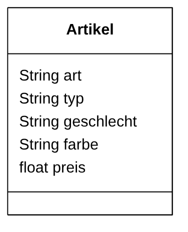

**Tabellenschema:** [](https://raw.githubusercontent.com/ValentinHerrmann/dbiu_databases/main/dbiu_databases/artikel.schema.png)

```text
Artikel(String art, String typ, String geschlecht, String farbe, float preis)
```


#### Database in version: 29 - dbiu.bundesland

**UML:** [](https://raw.githubusercontent.com/ValentinHerrmann/dbiu_databases/main/dbiu_databases/bundesland.png) [](https://raw.githubusercontent.com/ValentinHerrmann/dbiu_databases/main/dbiu_databases/bundesland.pdf)

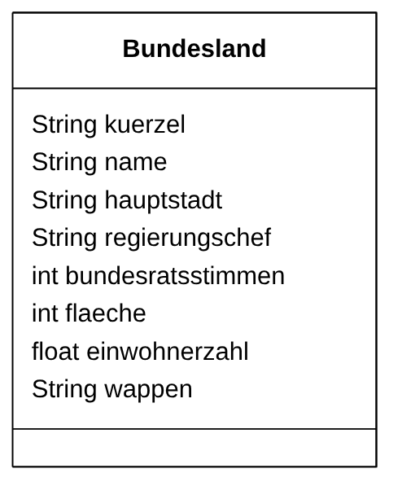

**Tabellenschema:** [](https://raw.githubusercontent.com/ValentinHerrmann/dbiu_databases/main/dbiu_databases/bundesland.schema.png)

```text
Bundesland(String k̲u̲e̲r̲z̲e̲l̲, String name, String hauptstadt, String regierungschef, int bundesratsstimmen, int flaeche, float einwohnerzahl, String wappen)
```


#### Database in version: 30 - dbiu.sportverein

**UML:** [](https://raw.githubusercontent.com/ValentinHerrmann/dbiu_databases/main/dbiu_databases/sportverein.png) [](https://raw.githubusercontent.com/ValentinHerrmann/dbiu_databases/main/dbiu_databases/sportverein.pdf)

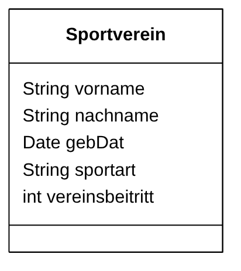

**Tabellenschema:** [](https://raw.githubusercontent.com/ValentinHerrmann/dbiu_databases/main/dbiu_databases/sportverein.schema.png)

```text
Sportverein(String v̲o̲r̲n̲a̲m̲e̲, String n̲a̲c̲h̲n̲a̲m̲e̲, Date g̲e̲b̲D̲a̲t̲, String sportart, int vereinsbeitritt)
```
